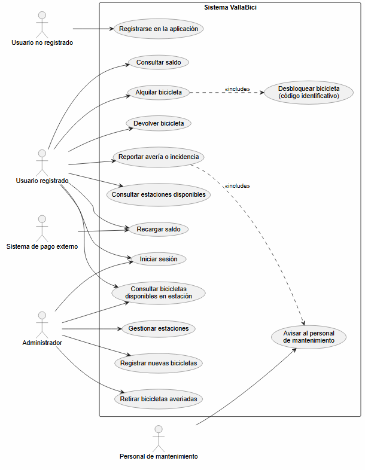
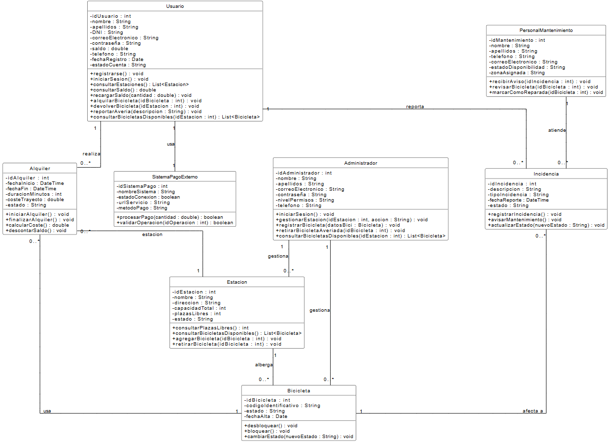
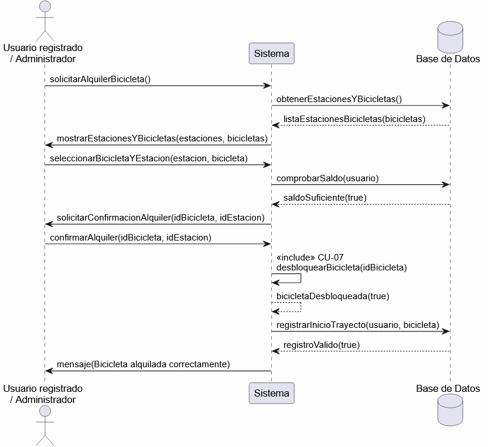

# VallaBici – Public Bike Rental System (Software Analysis & UML Design)

Analysis and design of **VallaBici**, an application to manage a public bike rental service in a city. Team project for the Development Environments module (1st year, CFGS DAW) at IES Galileo, Valladolid.

The project covers the full analysis phase of a software product: gathering requirements from a client, identifying actors and use cases, specifying each use case in detail, modelling the main interactions with sequence diagrams and designing the class structure, which was then translated into Java class skeletons.

## What the system does

- Citizens register (email, password and ID number), log in and check the stations available in the city and the bikes at each one.
- Registered users top up their balance through an external payment system, rent a bike by entering its code, and return it at any station; the cost of the trip is calculated and charged automatically.
- Users can report faults, which automatically notify the maintenance staff.
- The administrator manages stations, registers new bikes and removes damaged ones.

## Deliverables

| Document | Contents |
|---|---|
| [`docs/01-initial-requirements.pdf`](docs/01-initial-requirements.pdf) | Initial requirements agreed with the client |
| [`docs/02-use-cases-and-uml-diagrams.pdf`](docs/02-use-cases-and-uml-diagrams.pdf) | Actors, use case diagram, specification of 14 use cases (CU-01 to CU-14), sequence diagrams and class diagram |
| [`src/`](src) | Java class skeletons generated from the class diagram |

*The documentation is written in Spanish.*

## Diagrams

### Use case diagram
Five actors: unregistered user, registered user, administrator, maintenance staff and external payment system.

### Class diagram
Main classes: `Usuario`, `Administrador`, `PersonalMantenimiento`, `Estacion`, `Bicicleta`, `Alquiler`, `Incidencia` and `SistemaPagoExterno`, with their attributes, methods and associations.

### Sequence diagram – Rent a bike (CU-06)

## Skills applied

- Requirements analysis and communication with a client
- UML: use case, sequence and class diagrams
- Detailed use case specification (main flow, alternative flows, pre- and postconditions)
- Translating a class diagram into Java classes
- Teamwork and version history of the documentation

## Team

- **Sandra Sanz Badás** – analyst and developer
- **Javier González Mejías** – analyst and developer
- **Joaquín García Plaza** – client role
